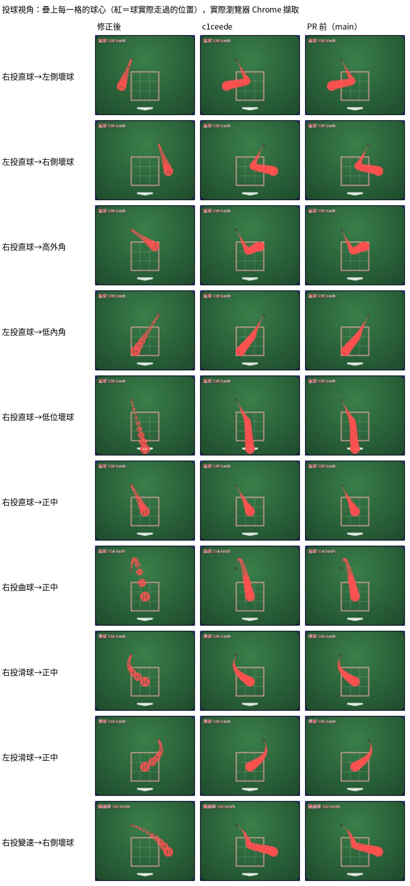

# Phase 9 玩法擴充 RFC：招募降價、投球動畫、戰術風格、特性訓練、單場 MVP

- 狀態：草案（PR 1 已實作，PR 2～4 待審）
- 基準：`origin/main` e6473bc（PR #19 合併後）。`CLUB_SCHEMA_VERSION = 10`、`RULES_VERSION = 9`、`AUTO_COACH_VERSION = 1`
- 原則：
  - 比賽引擎與既有存檔的結果不變。`src/sim/__golden__`、`src/v2/application/__golden__` 一律不重新產生。
  - 新功能需要改動比賽時，一定要升版本號，並讓舊回放照舊重播。
  - 每個 PR 獨立送審、按順序整合，不自行合併。

## 0. PR 拆分與相依

| PR | 內容 | 存檔版本 | 相依 |
|---|---|---|---|
| PR 1 | 招募每次 +200；修正投球視角直球軌跡 | 不變（V10） | — |
| PR 2 | 戰術四風格（均衡／強攻／機動／守備）＋推薦戰術＋單場戰術摘要（已實作） | V10 → **V11** | PR 1 |
| PR 3 | 球員特性訓練（潛能池、單一訓練槽、負面特性改善）（已實作） | V11 → **V12** | PR 2 |
| PR 4 | 我方單場 MVP 與 MVP 成長 | V12 → **V13** | PR 3 |

存檔版本預先排好順序，每個 PR 只加一層遷移：

- `MIGRATABLE_VERSIONS` 依序加入 10、11、12。
- 每一層都沿用既有的備份鍵 `dice-baseball.club.v3.backup-schemaN`。
- 遷移是純函式，可以重試；寫入失敗時保留原檔，下次載入再跑一次。
- 任何一層都不補發過去比賽的獎勵（MVP、訓練進度、戰術摘要都從遷移後的下一場才開始計）。

PR 3、PR 4 都會讀 Phase 8 的 `SettledMatch.lines`（出場與成績），所以排在戰術之後。三者之中 PR 4 動到「下一場的能力」，影響面最大，所以放最後。

---

## 1. 招募：每次 +400 → +200（PR 1）

| | 舊（2,000＋400） | 新（2,000＋200） |
|---|---|---|
| 第 2 次 | 2,400 | 2,200 |
| 第 16 次 | 8,000 | 5,000 |
| 前 16 次合計 | 80,000 | 56,000 |
| 第 30 次 | 13,600 | 7,800 |

- `RECRUIT_CONFIG` 只改 `stepFunds`。`baseFunds 2000`、`maxPlayers 30` 不變，公式 `recruitCost(n) = base + n × step` 不變。
- 介面上的價格（候選人視窗、確認按鈕、簽約後的「下一次」提示）和實際扣款都來自 `recruitCost(club.recruitment.count)`，畫面沒有另寫公式。測試會比對畫面價格與扣款。
- **既有存檔：**
  - 不退款，`recruitment.count` 不重設。
  - 下一次招募直接用新公式。例如已經用舊價付過 2 次（2,000、2,400），第 3 次是 2,400，而不是 2,800。
  - 舊的支出紀錄原樣保留；`economyViolations` 驗證的是紀錄本身的加總，不受價格公式影響。
  - 測試：`recruitMarket.test.ts` 的「Phase 9：簽約金改成每次 +200」。
- 不需要遷移：價格是從 count 算出來的，不存在存檔裡。

### 平衡差異（`npm run balance:v2`，與 main 比較）

A、B、C 三種策略不招募，輸出逐字相同。只有 D（招募＋養成）改變：

| D 第 30 天 | main | PR 1 |
|---|---|---|
| 累計資金 | 869,071 | 858,362 |
| 剩餘資金 | 45,331 | 69,344 |
| 上場平均等級 | 10.6 | 7.8 |
| 上場平均能力 | 6.72 | 6.60 |
| 30 天勝率 | 56.7% | 53.9% |
| 到達 業餘／挑戰者／職業／傳奇（三種子） | 1/2/1、3/3/2、4/4/3、10/8/6 天 | 3/1/2、5/3/4、10/5/6、11/10/7 天 |

**解讀：**
- D 是貪婪腳本：「付得起就先招募，名單滿了就釋出最差的預備球員再招募」。
- 降價後，它在前幾天更快湊滿 30 人（第 3 天已 30 人），也更頻繁地把 Lv.1 新人換上場，所以上場平均等級降低，資金反而剩得多。
- 能力只差 0.12，晉級時程大致相同，傳奇平均晚約 1 天。
- 這是腳本策略的特性，不代表玩家會變弱。實際玩家多半不會一直換掉已練起來的先發。
- 結論：降價讓「多招幾個看看」的門檻變低，沒有出現招募就能取代養成的捷徑（能力天花板仍由等級決定）。
- `balance:v2:ranked`（45 天，各聯盟勝率）：B、E 不變；D 招募＋養成在業餘／挑戰者／傳奇從 61%／58%／58% 變成 63%／61%／61%（新秀、職業持平），仍在積分制設計的區間內。
- `bench:v2:idle`：結算耗時與 main 同一量級（招募價格不在比賽路徑上；96 場離線結算平均約 133 ms）。

---

## 2. 投球視角：直球看起來像曲球（PR 1）

### 現象
投球視角（`src/ui/pitchCam.ts`）裡，直球在最後一段明顯轉彎，有時比曲球還彎。

### 根本原因
- **資料流本身正確。** `replayView` 把該格 pitch 事件的 `e.pitch` 和當時的投手交給 `stage.pitch(ms, pitch, thrower)`，沒有用文字標籤或預設值；新增的測試會確認這一點。
- **問題出在 Phase 6B 的防雷設計。** 結果提交前，投球視角的球先朝好球帶中心（中性點）飛到軌跡的 80%（`APPROACH = 0.8`）；提交後才知道真正的進壘點（壞球在好球帶外），再把剩下的 20% 帶過去。
- **兩條終點不同的直線，只要接在一起就一定有轉角。** 直球從出手點到進壘點本來是一條直線：
  - 前段朝 A 飛、後段改去 B，球心在接點一定要轉向。進壘點離中心越遠（左右壞球、好球帶角落），轉得越急。
  - **PR 前（main）**：揭曉段混合「球的位置」，球心與拖尾都在最後 20% 急轉。
  - **c1ceede（PR #20 第一版）**：揭曉段改成移動整條軌跡的終點，每一格的**拖尾**都是直的；但**球心**在時間軸上仍然從「往中心」轉成「往真正的進壘點」，等於只修了拖尾（review P2）。

### 方案比較（PR #20 review）

| | A：一開始就飛向真正的進壘點 | **B：揭曉前不橫移，揭曉後播完整飛行（採用）** |
|---|---|---|
| 防雷 | ✗ 進壘點由結果決定（壞球在好球帶外）。提交前就往外飛，等於提前公布好壞球；違反 `ReplayStage.pitch()` 的契約（「不能依好壞球決定進壘點」，phase6b 測試也會擋下） | ✓ 提交前畫面上的球只在出手點變大（從捕手看，球正朝鏡頭飛來），不透露任何方向 |
| 球心路徑 | ✓ 直線 | ✓ 直線：完整的飛行從出手點開始，沿著 `pitchPoint` 走到進壘點 |
| 其他球種 | ✓ | ✓ 揭曉段的每一格都在這個球種的真正軌跡上（曲球先飄後墜、滑球橫移、左投相反） |
| 自然程度 | 前段較長 | 揭曉段約 10 格（≤ 160 ms）走完全程，用輕微加速（`revealProgress`，捕手視角下越近越快）；揭曉前後位置連續 |
| 修改量 | 要讓 `stage.pitch()` 拿到結果、改防雷契約與測試 | 只改 `PitchCam.approach()` / `finish()`，`ReplayStage` 介面與呼叫端不變 |
| 回放相容 | 只動畫面 | 只動畫面 |
| 測試難度 | 要重寫防雷測試 | 逐影格量測即可 |

折衷方案「前段只往中心移動一點點」也評估過：要讓直球的球心偏離小於 0.03，前段在畫面上幾乎不能移動（< 4%），效果與 B 相同卻多一個轉角，因此不採用。

### 修正（方案 B）

- `approach()`：球停在出手點、只稍微變大（還很遠），沒有拖尾。
- `finish()`：從出手點沿著 `pitchPoint(球種, 慣用手, 出手點, 真正的進壘點, revealProgress(u))` 播完整的飛行；拖尾就是球走過的路。
- 防呆：
  - 前段還沒播完就投下一球時，舊的那一球立刻停止繪製。
  - `cancel()` 之後不再畫任何影格。
- 只改畫面：
  - `ReplayStage`、比賽引擎、亂數、`RULES_VERSION` / `AUTO_COACH_VERSION` 與存檔都不變。
  - 進壘點仍是畫面專用的 `Math.random`，不是比賽亂數。

### 量測（直球，右投，小窗 118 × 94 px；左投鏡像相同）

每格依序是 ballPathBend / trailBend / lateralAcceleration。修正後一欄另外列出 transitionJump。

| 進壘點 | PR 前（main） | c1ceede | 修正後 |
|---|---|---|---|
| 正中 | 0.000 / 0.000 / 0.000 | 0.000 / 0.000 / 0.000 | 0.000 / 0.000 / 0.000，0.058 |
| 高內角 | 0.343 / 0.343 / 0.022 | 0.343 / **0.000** / 0.022 | **0.000 / 0.000 / 0.000**，0.058 |
| 高外角 | 0.386 / 0.387 / 0.021 | 0.386 / **0.000** / 0.021 | **0.000 / 0.000 / 0.000**，0.058 |
| 低內角 | 0.233 / 0.235 / 0.013 | 0.233 / **0.000** / 0.013 | **0.000 / 0.000 / 0.000**，0.058 |
| 左側壞球 | 0.622 / 0.628 / 0.033 | 0.622 / **0.000** / 0.033 | **0.000 / 0.000 / 0.000**，0.058 |
| 右側壞球 | 0.238 / 0.243 / 0.013 | 0.238 / **0.000** / 0.013 | **0.000 / 0.000 / 0.000**，0.058 |
| 低位壞球 | 0.095 / 0.097 / 0.005 | 0.095 / **0.000** / 0.005 | **0.000 / 0.000 / 0.000**，0.058 |

c1ceede 的 trailBend 全部是 0，ballPathBend 卻跟 PR 前一模一樣：只量拖尾抓不到這個錯誤。

**變化球**：修正後的 ballPathBend 等於該球種的真正軌跡（例如右投曲球正中 0.281，真正 0.282；右投滑球左側壞球 0.319，真正 0.323）。修正前曲球、變速球的形狀反而被扭曲（右投變速球→左側壞球：修正前 0.644，真正 0.054）。

### 測試（`src/ui/pitchCam.test.ts`，驅動真正的 PitchCam，逐影格記錄 canvas 上的球心與拖尾）
- 閾值：
  - ballPathBend、trailBend < 0.03（約 1.5 px）。
  - lateralAcceleration < 0.01（每格橫向 < 0.5 px）。
  - transitionJump：不超過揭曉段一般一步的 1.5 倍，且小於連線的 15%。
- 直球：左右投 × 8 個進壘點（正中、四角、左右壞球、低位壞球），四項指標都在閾值內，終點等於真正的進壘點。
- 揭曉前每一格球都在出手點、沒有拖尾（不透露方向）；揭曉後每一格都在真正的 `pitchPoint` 曲線上。
- 曲球：上飄＋末段下墜多於直球，路徑彎度等於真軌跡。
- 滑球：左右投方向相反。
- 變速球、指叉球：路徑彎度等於真軌跡且大於直球。
- 取消與下一球：
  - 揭曉中 `cancel()` 之後不再畫。
  - 前段 `cancel()` 後 `finish()` 不畫。
  - 前段未完就投下一球，舊球停止。
  - 連投兩球，第二球的拖尾不繼承第一球。
- 修正前的兩種畫法用同樣的量測：直球 ballPathBend、lateralAcceleration 都超過閾值；c1ceede 的 trailBend 在閾值內，證明只量拖尾不夠。把新測試套在 main 與 c1ceede 的 `pitchCam.ts` 上各有 23 項失敗，修正後全過。
- `phase6b.dom.test.ts`：完整播一場，交給動畫的球種序列等於引擎 pitch 事件的 `pitch` 序列（含直球），每一球都附投手。

---

## 3. 戰術四風格（PR 2，V11）— 已實作

- 狀態：PR 2 實作。
- 下面是實作後的規則；原本草案與實作不同的地方（機動型的盜壘門檻、觸擊局數、「積極」跑壘的數值、存檔大小）都有標註原因。

### 架構：一個決策框架、四組預設、少數風格專用判斷
- 共用框架：`StylePolicy`（`src/v2/application/autoCoach.ts`）。
  - 四種風格走同一套判斷順序：換投 → 後段守成 → 左右相剋 → 守備替補 → 佈陣；代打 → 代跑 → 觸擊 → 盜壘 → 打帶跑。
  - 差別只在 `COACH_PRESETS` 的參數，以及由參數開關的風格專用判斷。
  - 沒有複製四份程式，也沒有任何能力加成。
- `BalancedPolicy` 保留為 `StylePolicy('balanced')` 的子類別；`createPolicy(style, params)` 等於風格預設再蓋上玩家的進階設定。
- 新增的參數（均衡型全部維持原本的數值或關閉）：
  - 觸擊：`buntFromInning`、`buntMaxLead`、`buntBatterMax`
  - 風格專用開關：`hitAndRun`、`pinchRun`、`protectSlugger`、`lateRelief`、`defensiveSubs`
- 均衡型的判斷**逐指令不變**。證據是 `coach-balanced-golden.json`：用 main（重構前）的程式產生，4 組均衡參數 × 100 場，每場我方全部指令的雜湊與比分。另外原有的 club golden（336 場）與 sim golden（160 場）都沒有重新產生。

| 風格 | 換投 | 盜壘 | 觸擊 | 專用判斷 |
|---|---|---|---|---|
| 均衡 | 到疲勞門檻；相剋換投至少面對 3 人 | 成功率 ≥ 0.75（二盜三 +0.1）、比分差 ≤ 3 | 8 局起、平手或落後 1 分、打擊＋長打 ≤ 10 | — |
| 強攻 | 同均衡 | ≥ 0.85 | 不觸擊 | 保護強打：長打 ≥ 7 的打者打擊時不盜壘、不被代打 |
| 機動 | 同均衡 | ≥ 0.70、比分差 ≤ 4 | 7 局起、落後 1 到領先 1、打擊＋長打 ≤ 11 | 打帶跑：一壘有人、跑者速度 ≥ 6、打者打擊 ≥ 6、成功率 0.55 以上但不到盜壘門檻；代跑：7 局後比分差 1 分內，速度 ≤ 4 的跑者換成快至少 3 的板凳 |
| 守備 | 疲勞門檻 −15 球（下限 60%）；相剋換投至少面對 2 人 | 同均衡 | 同均衡 | 後段守成：8 局後領先 1～3 分、投手用掉七成體力就換最好的後援，9 局起有終結者用終結者；守備替補：7 局後領先 1～3 分，板凳守同守位至少好 2 就換上 |

- **引擎做不到的強攻行為**：引擎沒有「打擊策略」類的指令，例如積極出棒、等球、拉打。所以強攻型只能透過「不做什麼」（不觸擊、少盜壘、不代打強打者）來表現，不會讓打者變得更會打長打。PR 2 不新增隱性加成。

### 機動型與「積極」跑壘的數值（實作與草案不同）
- **草案：** 機動型盜壘門檻 0.65、6 局起觸擊。
- **模擬結果：** 0.65 讓勝率掉了約 2 個百分點；邊際盜壘的成功率不到 8 成，等於白送出局數。打帶跑、代跑影響不大。
- **定案：**
  - 機動型盜壘門檻 0.70、7 局起觸擊。
  - 進階設定的「積極」也從 0.65 改成 0.70。
  - 舊存檔裡的 0.65 原樣保留：畫面顯示「積極」；只有玩家點了跑壘分段才會換成新數值，改其他設定不會動到它。

### 守備型提早換投：`fatigueMargin` 的範圍（PR #20 review 的決定，已實作）
- 範圍擴充為 −30～30 的整數。
- 實際換投門檻 `pitchingChangeAt(limit, margin)`：
  - `margin < 0` 時是 `max(limit + margin, ceil(limit × 0.6))`。
  - 0 以上時是 `limit + margin`，跟原本的條件逐字相同。
- 測試：
  - 接受 −30、−15、0、30；拒絕 −31、31、2.5、NaN。
  - 下限：門檻 50 的投手設 −30，最早在 30 球換投。
  - 守備型在 85 球換投，其他風格在 100 球。

### 介面
- **推薦戰術卡片**：見下節。
- **四張風格卡片**：圖示、名稱、一句話描述、適合、優點、缺點，以及「已選擇」或「目前使用」標記。手機一欄、桌面兩欄。
- **進階設定**：用 `
` 收合，預設收起，展開後重畫也保持展開。
  - 摘要列顯示「使用 X 型的預設」或「自訂」。
  - 內容是跑壘三檔、後段調度、犧牲觸擊，以及「恢復預設」按鈕。
- **規則**：
  - 選卡片：進階設定換成那個風格的預設。
  - 改任何一項進階設定：標記「自訂」。
  - 恢復預設：換回目前風格（不是均衡型）的預設。
  - 存檔只存 `{ style, params: { stealMin, latePlatoon, sacBunt } }`；其他參數一律跟著風格。
- **沿用原本的機制**：草稿、儲存、取消修改、多分頁版本衝突（在鎖內比對戰術版本）、下一場起生效。

### 推薦戰術（`src/v2/domain/tacticsAdvice.ts`）
- 只看上場的陣容：先發 9 人、先發投手、牛棚。不含板凳與預備名單。
- 純函式，不抽亂數、不呼叫外部服務、不改玩家的選擇。
- 三個傾向分數（能力 1～10）：
  - 長打 = 平均長打 − 打者四項平均 ＋ 0.25 × 強打者特性 − 0.15 × 亂揮特性
  - 速度 = 平均速度 − 打者四項平均 ＋ 0.2 ×（盜壘＋跑壘特性）＋ 0.1 × 觸擊特性
  - 投手 = 投手陣容平均（先發算兩人，（球威＋控球）÷ 2）−（平均打擊＋平均長打）÷ 2 ＋ 0.25 × 終結者 ＋ 0.15 × 鐵臂 − 0.15 ×（控球不穩、易被轟、體力差）＋ 0.2 ×（平均守備 − 打者四項平均）＋ 0.1（牛棚 ≥ 4 人）
- **標準化**：z =（分數 − 一般球隊中位數）÷ 一般球隊的離散程度。
  - 中位數與離散程度用 `generateTeam` 產生 1,000 支隨機球隊量出：長打 0／0.42、速度 0.48／0.45、投手 −0.07／0.82。
  - 速度本身就偏高，所以要先扣掉一般水準。
- 最高的 z ≥ 1.3 就推薦對應的風格，否則推薦均衡型。
  - 隨機球隊大約 75% 推薦均衡型，其他三種各約 8～9%。
  - 畫面用實際的平均能力說明理由。

### 單場戰術摘要（`SettledMatch.tactics`）
- **來源**：`runMatchWithGame` 一邊打一邊累加我方的事件與指令。
  - 盜壘：steal 事件；打帶跑揮空、跑者出局也算一次嘗試。
  - 觸擊：觸擊指令；成功是犧牲觸擊推進。
  - 其他：打帶跑指令數；我方的 substitution 事件（換投、先發被換下的局數、守備替補、代打、代跑）。
- 不抽亂數、不改比賽；不推估「多得幾分」。
- **存檔格式**：12 個欄位的精簡陣列（跟 Box Score 一樣），約 45 bytes。
  - 欄位依序：風格、自訂、盜壘嘗試／成功、觸擊嘗試／成功、打帶跑、換投、先發下場局數、守備替補、代打、代跑。
  - 近期 50 場約多 2.3 KB；存檔大小測試的上限從 100,000 放寬到 105,000。
- **舊比賽**：沒有摘要就顯示「未記錄」，不用目前選的戰術回填。
- **離線批次**：每一場都記下當場計畫裡的風格。新設定從下一場還沒開始的比賽生效；進行中固定的那一場維持舊風格。重送同一批結果不會重複記錄。

### 存檔 V10 → V11
- 只改版本號：revision ＋1，`migratedFrom` 記下原始版本。原始文字逐字備份到 `backup-schema10`。
- **完全保留**：球員、能力、生涯數據、招募次數、帳務、聯盟、積分、降級紀錄、近期比賽、Replay、挑戰 Replay、進行中固定的比賽計畫、均衡型的進階參數。
- 不重新模擬、不發資源。
- V10 存檔的風格不是均衡型時，遷移會丟錯（V10 不可能有其他風格）。

### 回放與教練版本
- `AUTO_COACH_VERSION` 從 1 升到 2，記在每場比賽上。
- 已存的 Replay 用的是記錄下來的指令，不重新執行教練。
- 會重新執行教練的情況：進行中固定的比賽計畫、還沒結算的比賽。V10 以前這些全部是均衡型，而均衡型在版本 2 逐指令相同（golden 證明），所以舊比賽重新模擬的結果一樣，不需要保留舊版教練程式。
- 新風格的決策是確定性的：同樣的狀態一定得到同樣的指令，不額外消耗比賽亂數。

### 平衡
完整數據見 `docs/balance/v2-phase9-tactics.md`（`npm run balance:v2:tactics`）。

- 四種風格的行為差異明顯，勝率差距大多在 ±2 個百分點內。
- 機動型在高速度球隊最有利（+2.7 個百分點）；守備型在投手好、能力低的球隊最好或並列最好。
- 強攻型受限於引擎沒有打擊策略指令，勝率與均衡型相當。

---

## 4. 球員特性訓練（PR 3，V12）— 已實作

- 狀態：PR 3 實作。
- 平衡報告：`docs/balance/v2-phase9-traits.md`。
- 程式：`src/v2/domain/traitTraining.ts`、`application/economyService.ts`（開始、取消）、`application/settlementService.ts`（進度、分段）、`ui/trainingPanel.ts`。

### 資料模型（V12）
- 跟模擬引擎共用 `TraitId`、`TRAITS`、`TRAIT_CONFLICTS`，沒有第二套特性系統。19 個特性在引擎裡都有作用。
- **球員的養成結果**跟球員放在一起：`PlayerRecord.dev?: { learned: TraitId[]; removed: TraitId[] }`。
  - 沒有養成就不寫這個欄位。
  - 原生特性留在 `record.player.traits`（Lv.1 的原始資料），永遠不改。
- **球團的訓練狀態**：`ClubSave.training = { potentialVersion: 1, active: ActiveTraining | null, recent: CompletedTraining[] }`。
  - `active`：`playerId`、`trait`、`kind`（learn／improve）、`progress`、`need`、`startedAtMatch`、`lastCountedMatch`。
  - `recent`：最近 10 筆完成，給通知與歡迎回來摘要用。
- **潛能池不存檔**，每次用確定性演算法重算。`potentialVersion` 預留給以後改演算法：到時候遷移要照舊版本把未完成的潛能固定下來。
  - 已經學到的特性存在 `dev`、訓練中的項目存在 `active`，所以改演算法不會影響已經花錢的部分。

### 潛能池
- **輸入**：只用固定資料：球團種子、球員編號（FNV-1a 雜湊後用 `deriveSeed(…, SEED_SALT.potential)`）、角色、Lv.1 原始能力、原生特性。升級、換陣容、重新整理都不會改變。
- **候選**：同角色的正面特性，排除已擁有的，以及跟原生**正面**特性互斥的。
  - 跟原生**負面**特性互斥的可以留在池裡（例如守備不穩 ↔ 好手套），但要先改善那個負面特性才能學。
- **加權**：權重 = 1.5^(適合的能力 − 5)，金色再 ×0.4。不放回地抽 3 個。
  - 打者：怪力看長打；盜壘、跑壘看速度；觸擊看打擊與低長打；好手套看守備。
  - 投手：鐵腕看體力；終結者、奪三振看球威；滾地球看控球。
- **改善**：原生的負面特性一律可以改善（6 個負面特性在引擎裡都有作用）。

### 規則
- **有效特性** =（原生 − 已改善）∪ 已習得。`effectivePlayer` 在 `leveled()` 之後套用，所以 `resolveRoster`、比賽計畫、推薦戰術都自動使用。
- **正面特性上限 3 個**（原生的也算）。第一版平衡曾下修為 2，PR #22 review 重新比較方案 A（2）／B（3）／C（3＋稀有漲價）後採用 B，數據見平衡報告。負面特性不占名額；原生就超過上限的舊資料不算錯，但不能再學。
- **合法性規則（開始、讀檔、完成共用）**：`staticTrainingBlock(clubSeed, record, trait, kind)` 是唯一的靜態資格判斷：
  - 特性存在、角色相符；`learn` 只能是正面特性、`improve` 只能是原生的負面特性（`wrong-kind`）。
  - `learn`：在個人潛能池、還沒擁有、不跟有效特性互斥、正面特性未達上限。`improve`：還沒改善過。
  - 動態條件（訓練槽、資金與經驗、操作序號）只在開始訓練時檢查：`trainingBlock` = 靜態 ?? 動態；序號由 `checkSeq` 檢查。
  - `validateClub` 的進行中訓練只檢查靜態資格（現在錢不夠、訓練槽被自己占用都不算錯）。
  - `advanceTraining` 完成前再檢查一次靜態資格，套用後再跑 `developmentIssues`；不合法就丟 `TrainingInvariantError`，結算整批不記、不存檔，原本的存檔不變，不會學到非法特性或重複解鎖。
- **潛能池版本（`potentialVersion`）相容規則**：潛能池不存檔、每次重算，所以存檔的 `training.potentialVersion` 必須等於程式的 `POTENTIAL_VERSION`（目前 1），不同就拒絕讀取。要改潛能池演算法時：版本 +1、加一個遷移，把進行中訓練照舊版本驗證（或取消並退款），已習得的特性在 `dev.learned`，不受影響；不可以不升版就改演算法。
- **到不了上限的球員**：不修改潛能池；介面用 `positiveCeiling` 說明這位球員最多能到幾個正面特性。
- **單一訓練槽**。開始時一次扣款，沒有失敗機率；取消不退款、進度不保留；訓練中的球員不能釋出，要先取消。
- **成本**（定案）：

| 類別 | 資金 | 經驗 | 正式出賽 |
|---|---|---|---|
| 一般 | 6,000 | 1,000 | 200 |
| 稀有 | 15,000 | 2,500 | 500 |
| 改善 | 8,000 | 1,200 | 300 |

- **進度**：只在 `settleOutcomes`（正式一般比賽）裡計算。
  - 訓練中的球員出現在該場 `lines`（打者或投手，含代打、代跑、守備替補、後援）才 +1。
  - `matchIndex ≥ startedAtMatch`，而且大於 `lastCountedMatch`，所以同一場不會算兩次。
  - 開始時進行中那一場已經固定，進度從下一場起算。
  - 挑戰賽、回放不會經過這裡。

### 離線分段
- `matchesBeforePossibleChange(club)` = min(可能降級, 訓練最快完成)。MVP 能力成長之後也接在這裡。
  - 訓練最快完成 = `need − progress`：一場最多 +1，所以只會早切、不會晚切，也不會為了切段重打任何一場。
  - 訓練中的球員不在這批會用到的陣容（配置或固定的進行中比賽）裡時，這批比賽他不可能出場，就不切段。
- `settleOutcomes` 碰到訓練完成那一場就停止記錄這批剩下的結果，跟降級一樣；`settleDueUnsaved` 再用新的有效陣容從下一場規劃。
- 中斷時，已結算的前綴照常保存，進度跟結算游標在同一次轉換裡前進。重送、多分頁靠結算游標保證不重複。

### 存檔 V11 → V12
- 加上空的訓練槽，球員不寫 `dev`，不補發歷史進度；其他欄位一個字都不動。
- 原始文字備份到 `backup-schema11`。
- 遷移 Golden：同一份 V11 打開後離線 8 小時結算的 96 場與最後狀態，跟 main 的程式一模一樣（`club-v11-settle-golden.json`）。

### Replay 相容
- 已存的 Replay 與固定的進行中比賽，用的是當時的完整陣容快照（含當時的特性），不會因為之後的訓練改變。
- 沒有訓練的球團：比賽計畫跟以前完全一樣。club golden、教練 golden、`balance:v2`、`balance:v2:tactics`、`balance:v2:ranked` 的輸出都跟 main 相同。

### 已知限制
- 觸擊○只對教練會叫他觸擊的弱打者有用；好手套單場的效益很小。
- 體力差在 V2 只影響換投時機，勝率幾乎不變。
- 這些仍可訓練（引擎有作用），平衡報告有標記。

---

## 5. 我方單場 MVP（PR 4，V13）

> PR 4 定案。公式與參數在 `src/v2/domain/mvp.ts`（`MVP_CONFIG`），戰報、球員詳情、平衡腳本都呼叫同一組函式；平衡數據見 `docs/balance/v2-phase9-mvp.md`。

### 資料來源（先盤點，不假設）
- **Phase 8 的 `lines`（可靠）**：打者 pa ab h d t hr r rbi bb so ibb sf sh gidp roe hbp；投手 bf outs h hr r er bb k ibb hbp。
  - `hbp`：引擎沒有觸身球，永遠是 0（照樣計入公式，不影響）。
- **`lines` 沒有、要從正式事件流補的**：盜壘成功／失敗（`steal` 事件）、勝利打點（`play` 事件＋比分）。
  - 在 `runMatchWithGame` 原本就在走訪的事件迴圈裡收集成 `MatchResult.mvpFacts`，只讀事件，不下指令、不消耗亂數（Replay 測試驗證）。
  - 不擴充 `BAT_STORE`，舊比賽的統計格式不變。
- 單場 MVP 只存「誰、評分、盜壘、勝利打點、這次之後的生涯次數、這次的成長」；名字從生涯數據取（球員釋出後也查得到）。

### 選法
- 每場正式一般比賽一位，勝場敗場都有；只比我方；打者、投手、替補、代跑、後援都能得獎。
- 晉級挑戰賽不經過正式結算，沒有 MVP；觀看 Replay 不改存檔；舊比賽不回填，戰報顯示「未記錄」。
- 完全確定性：只讀該場的 `lines` 與 `mvpFacts`，評分用整數（千分之一分）。

### 打者分數（千分之一分）
- 1B 900、2B 1,250、3B 1,600、HR 2,000、BB／HBP 700（含故意四壞）、出局 −270、RBI 100、得分 0、SB 200、CS −400。
- **安打不重複計分**：一壘安打 = 安打 − 二壘 − 三壘 − 全壘打；全壘打只算一次 2.0。
- **出局** = 打數 − 安打（含三振、失誤上壘）＋ 高飛犧牲打 ＋ 雙殺打（雙殺多算一個出局）。
- **犧牲觸擊**：不扣分（V2 是教練的戰術決定，不是打者的失敗）。
- **打點 0.1**：只是小幅加權。長打的價值已經在安打權重裡，打點不會把它放大；得分不另外加權（避免跟上壘重複）。
- **勝利打點**：不加分，只當同分規則的第一順位（資料可靠：取得「之後沒再被追平」領先的那個打席；靠失誤、雙殺取得領先不算）。

### 投手分數
- (出局數 × 聯盟每出局平均自責分 − 自責分) × 尺度，也就是「比平均少失幾分」。平均水準的先發接近 0 分，好的先發才會高。
- 兩個參數都是量出來的（8,000 場：八種隊伍 × 四種戰術）：
  - 聯盟每出局自責分 **0.108**（每 9 局 2.92 分）。
  - 尺度 **1.48**：每場我方打者評分加總對得分回歸的斜率（R² 0.76），也就是打者「多得一分」值 1.48 評分；投手「少失一分」用同一個價值。
- 被安打、保送反映在自責分裡；三振不另外加分（已經反映在出局與自責分）；非自責分不扣（失誤不是投手的責任）。
- 沒有「所有投手扣分」的補丁，也沒有配額：投手長期約 27%（先發 22%、後援 5%），落在 25～35% 的目標內，是公式本身的結果。

### 同分規則
1. 評分（千分之一分）高的。
2. 有勝利打點的。
3. 同角色：打者比總壘打、投手比出局數；跨角色不比（數字意義不同）。
4. 同角色比名單順序（先發打序、先發投手在前）；跨角色時打者優先（固定規則，8,000 場裡跨角色同分 0 次）。
5. 球員編號字典序（保證分得出來）。
- 二刀流（同時有打擊與投球列）：各自評分，取較高的一個。
- 沒有我方球員數據的正式新比賽是資料異常：結算丟 `invalid-result`、整批不記，不默默指定第一位球員。

### 永久成長
- 資料：`PlayerRecord.mvp = { count, grants: [{ rating, atMatch }] }`，沒得過就不寫。
  - `count`：生涯 MVP 次數。到成長上限後仍繼續累計（榮譽紀錄）。
  - `grants`：每次成長一筆（+0.1 = 1 單位，最多 5 筆 = +0.5）。加成以整數單位存，套用時一次換算，不會有 0.30000000000000004。
  - 進度（距離下一次成長）= 10 − count mod 10；成長上限後是 null。
- 每 10 次一次 +0.1。能力選擇（確定性、可解釋、沒有亂數）：
  - 打者：流派的主要能力（力量→力量、速度→速度、技巧→打擊、防守→守備）；滿了就換其他能力裡最高的。
  - 投手：球威、控球中較低的一項（補短板）；兩項都滿才給體力。
  - 「還有沒有空間」用 **Lv.20 滿級能力 ＋ 已有的 MVP 加成** 判斷（≤ 9.9），所以之後升級也不會被上限 10 吃掉；全部都沒空間就這次不成長（不浪費）。
- 有效能力：原生（Lv.1）→ 等級成長（`leveled`）→ MVP 加成（`withMvpBonus`，min 10）→ 特性（`withDevelopment`）。原生 Lv.1 資料不改。
- MVP 不直接給資金或經驗。

### 生效時機與分段結算
- 跟訓練一樣：第 N 場達到門檻，N 場用原能力打完，第 N+1 場起生效。
- `matchesBeforePossibleChange` = min(可能降級, 訓練最快完成, **MVP 最快成長**)。
  - MVP 最快成長 = 可能出場、還能成長的球員裡最小的 (10 − 進度)。每場只有一位 MVP，所以這是證明（在這麼多場之內不可能有人成長），不是預測誰會得獎。
  - `settleOutcomes` 在成長那一場之後停止記錄（跟降級、訓練完成一樣），剩下的用新的有效陣容重新規劃；已經結算的不會重打，也不會多發 MVP。
- 分段變多之後的效能處理：讓出主執行緒的計數、進度回報跨段共用（不會因為每段都很短而整批不讓出），第二段起直接在工作副本上改、不每段整份複製球團。
- MVP 次數、成長、比賽、生涯、結算游標在同一次存檔；存檔失敗就全部沒有。

### 介面
- 戰報：本場 MVP（頭像、MVP 標示、角色、單場數據、得獎原因、這次的成長進度；點了打開球員能力）；舊比賽「未記錄」。
- 球員詳情（球員能力分頁）：能力表分成原始／等級／MVP／目前；MVP 紀錄（生涯次數、下一次成長的進度條、各項加成、是否到上限）。
- 歡迎回來：這段期間打者／投手各幾次、得獎最多的球員、能力提升（一位一行，最多 5 位，點名字看球員）。
- 在畫面上時的成長：跟「比賽結束」的提示合併成一則。

### 平衡（摘要）
- 一天 2 次上線約 192 場，所以成長比原本估計快很多：先發投手約 1.5 天就到 +0.5，30 天時上場球員平均 +0.43。
- 沒有正回饋壟斷：得獎最多的 1 人約 18～19%，有沒有成長幾乎一樣；前 3 人在後半段的占比也一樣。
- 會加速晉級：3 個種子都到傳奇時，51.2 天 → 42.7 天。放慢成長（每 25、50 次）幾乎沒差，關鍵是上限 +0.5 的大小；數據與建議見平衡報告。

---

## 6. 已知限制
- 招募降價後的 D 策略數字反映腳本行為，不是真實玩家。
- 戰術摘要只列事件，不歸因得分。
- 訓練與 MVP 的成本、權重要在各自的 PR 用長期模擬校正，本 RFC 的數字是初值。
